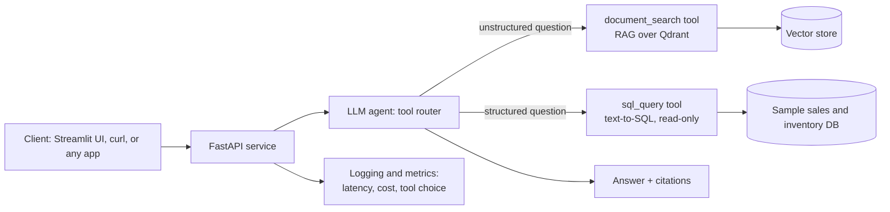

# LLM Data Agent API

**Ask business questions in plain English and get source-cited answers from documents and databases, served through a production-style API.**

> **Status: in development.** This README describes the target design and roadmap. Sections marked *planned* are not built yet. Results will be published here only after they are measured.

---

## Why this project

Business users usually need answers that live in two places at once: **unstructured documents** (reports, contracts, PDFs) and **structured data** (sales, inventory, and transaction tables). Most RAG demos cover only the first. Most text-to-SQL demos cover only the second, and few of either are served behind an API or evaluated with any rigor.

This project extends my earlier retrieval work into a single service that:

1. **Routes** each question to the right tool: document search, SQL, or both.
2. **Grounds** every answer in its source: the document page or the exact SQL query and rows used.
3. **Serves** the agent through a typed Python API that other applications can call.
4. **Measures** itself: routing accuracy, answer faithfulness, latency, and cost, tracked over time.

It builds on two earlier projects:
- [Interpretable Multi-modal RAG (ColPali, Qwen2-VL, Qdrant)](https://github.com/afzengin/MultiModel-RAG-ColPali-Qdrant-Qwen)
- [Enterprise PDF Intelligence & Search (LangChain, FAISS)](https://github.com/afzengin/PDF-RAG)

---

## Architecture



**Design principles**
- **Read-only by construction:** the SQL tool runs on a read-only connection with query validation and a row limit.
- **Every answer is traceable:** responses return citations (page references or the executed SQL) alongside the text.
- **Model-agnostic:** the LLM sits behind a small provider interface so hosted and open-source models can be swapped and compared.

---

## API (planned contract)

| Method | Endpoint | Purpose |
|---|---|---|
| `POST` | `/query` | Ask a question; the agent chooses tools and returns an answer with citations |
| `POST` | `/documents` | Upload and index a PDF |
| `GET` | `/health` | Service and dependency status |
| `GET` | `/metrics` | Latency, token cost, and tool-routing statistics |

Example request and response for `/query` (target shape):

```json
// POST /query
{ "question": "Which product category had the largest month-over-month sales drop, and what does the Q3 report say about it?" }
```

```json
{
  "answer": "...",
  "tools_used": ["sql_query", "document_search"],
  "citations": [
    { "type": "sql", "query": "SELECT ...", "rows_returned": 12 },
    { "type": "document", "source": "q3_report.pdf", "page": 7 }
  ],
  "latency_ms": 0,
  "cost_usd": 0.0
}
```

---

## Evaluation plan

A model is only as useful as the evidence that it works. The evaluation harness (*planned*) will run a fixed, versioned question set on every change:

| Metric | What it checks |
|---|---|
| **Routing accuracy** | Did the agent pick the right tool(s) for each question? |
| **SQL execution accuracy** | Does the generated query return the same result as a reference query? |
| **Answer faithfulness** | Is every claim in the answer supported by the cited sources? |
| **Retrieval hit rate** | Does the correct page appear in the top-k retrieved results? |
| **Latency and cost** | p50/p95 response time and cost per query |

Results will be reported here as a table once measured, with the question set committed to the repo so they are reproducible.

---

## Tech stack (target)

- **API:** FastAPI, Pydantic
- **Agent and LLMs:** tool-calling LLM agent; OpenAI GPT and AWS Bedrock models behind a provider interface
- **Retrieval:** embeddings + Qdrant vector search (from my earlier RAG work)
- **Structured data:** SQLite or DuckDB sample database (sales and inventory)
- **Packaging and deployment:** Docker; AWS deployment (*planned*)
- **Observability:** structured logging and a metrics endpoint

---

## Planned repository layout

```
llm-data-agent-api/
├── app/
│   ├── main.py            # FastAPI app and routes
│   ├── agent.py           # tool-routing agent
│   ├── tools/
│   │   ├── document_search.py
│   │   └── sql_query.py
│   ├── llm/               # provider interface (OpenAI, Bedrock)
│   └── schemas.py         # request/response models
├── eval/
│   ├── questions.jsonl    # versioned evaluation set
│   └── run_eval.py
├── data/                  # sample database and documents
├── tests/
├── Dockerfile
└── README.md
```

---

## Roadmap

- [x] Design: architecture, API contract, evaluation plan
- [ ] FastAPI skeleton with `/health` and typed schemas
- [ ] `document_search` tool reusing the Qdrant RAG pipeline
- [ ] `sql_query` tool with read-only guardrails over a sample sales and inventory database
- [ ] Tool-routing agent with citations in every response
- [ ] Evaluation set (30-50 questions) and `run_eval.py`
- [ ] `/metrics` endpoint: latency, cost, routing stats
- [ ] Dockerfile and local run instructions
- [ ] AWS deployment
- [ ] Publish measured evaluation results

---

## Author

**A. Furkan Zengin, Ph.D.** · Senior Data Scientist
[LinkedIn](https://www.linkedin.com/in/a-furkan-zengin-32ba8377) · [GitHub](https://github.com/afzengin)
