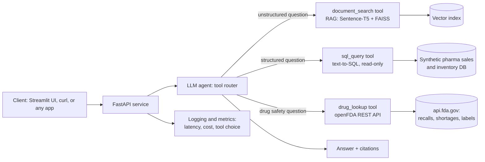

# LLM Data Agent API

**Ask pharmaceutical supply questions in plain English and get source-cited answers from documents, a sales and inventory database, and live FDA drug data, served through a production-style API.**

> **Status: in development.** This README describes the target design and roadmap. Sections marked *planned* are not built yet. Results will be published here only after they are measured.

---

## Why this project

Business users in pharmaceutical distribution need answers that live in three places at once: **unstructured documents** (supplier reports, policies, PDFs), **structured data** (sales and inventory tables), and **external sources** such as FDA recall and shortage notices. Most RAG demos cover only the first. Most text-to-SQL demos cover only the second, and few of either are served behind an API or evaluated with any rigor.

A typical question crosses all three: *"Which of our top-selling products have an active FDA recall, how many units are in stock, and what does our supplier policy say about returns?"*

This project extends my earlier retrieval work into a single service that:

1. **Routes** each question to the right tool or combination: document search, SQL, or the live openFDA API.
2. **Grounds** every answer in its source: the document page, the exact SQL query and rows used, or the FDA record.
3. **Serves** the agent through a typed Python API that other applications can call.
4. **Measures** itself: routing accuracy, answer faithfulness, latency, and cost, tracked over time.

It builds on two earlier projects:
- [Interpretable Multi-modal RAG (ColPali, Qwen2-VL, Qdrant)](https://github.com/afzengin/MultiModel-RAG-ColPali-Qdrant-Qwen)
- [Enterprise PDF Intelligence & Search (LangChain, FAISS)](https://github.com/afzengin/PDF-RAG)

---

## Architecture



**Design principles**
- **Read-only by construction:** the SQL tool runs on a read-only connection with query validation and a row limit.
- **Every answer is traceable:** responses return citations (page references, the executed SQL, or the FDA record ID) alongside the text.
- **Resilient external calls:** the openFDA tool uses timeouts, retries with backoff, and response caching, and the agent reports when the external source is unavailable instead of guessing.
- **Synthetic data only:** the sales and inventory database is generated for this project and contains no real company or patient data.
- **Model-agnostic:** the LLM sits behind a small provider interface so hosted and open-source models can be swapped and compared.

---

## API (planned contract)

| Method | Endpoint | Purpose |
|---|---|---|
| `POST` | `/query` | Ask a question; the agent chooses tools and returns an answer with citations |
| `POST` | `/documents` | Upload and index a PDF |
| `GET` | `/health` | Service and dependency status |
| `GET` | `/metrics` | Latency, token cost, and tool-routing statistics |

Example request and response for `/query` (target shape):

```json
// POST /query
{ "question": "Which of our top 20 products by sales have an active FDA recall, and what does our supplier policy say about returns?" }
```

```json
{
  "answer": "...",
  "tools_used": ["sql_query", "drug_lookup", "document_search"],
  "citations": [
    { "type": "sql", "query": "SELECT ...", "rows_returned": 20 },
    { "type": "fda", "endpoint": "drug/enforcement", "recall_number": "..." },
    { "type": "document", "source": "supplier_policy.pdf", "page": 4 }
  ],
  "latency_ms": 0,
  "cost_usd": 0.0
}
```

---

## Evaluation plan

A model is only as useful as the evidence that it works. The evaluation harness (*planned*) will run a fixed, versioned question set on every change:

| Metric | What it checks |
|---|---|
| **Routing accuracy** | Did the agent pick the right tool(s), including multi-tool questions? |
| **SQL execution accuracy** | Does the generated query return the same result as a reference query? |
| **Answer faithfulness** | Is every claim in the answer supported by the cited sources? |
| **Retrieval hit rate** | Does the correct page appear in the top-k retrieved results? |
| **Latency and cost** | p50/p95 response time and cost per query |

Results will be reported here as a table once measured, with the question set committed to the repo so they are reproducible.

---

## Tech stack (target)

- **API:** FastAPI, Pydantic
- **Agent and LLMs:** tool-calling LLM agent; OpenAI GPT, Azure OpenAI, and AWS Bedrock models behind a provider interface
- **Retrieval:** Sentence-T5 embeddings + FAISS (reused from my [PDF Intelligence project](https://github.com/afzengin/PDF-RAG)); a multimodal ColPali/Qdrant backend is a later upgrade
- **Structured data:** DuckDB with a synthetic pharmaceutical sales and inventory dataset
- **External data:** [openFDA](https://open.fda.gov/apis/) drug enforcement (recalls), shortages, and labeling endpoints
- **Forecasting:** product-level demand forecasting with backtested accuracy (*planned*)
- **Packaging and deployment:** Docker; Azure Container Apps (*planned*)
- **Observability:** structured logging and a metrics endpoint

---

## Planned repository layout

```
llm-data-agent-api/
├── app/
│   ├── main.py            # FastAPI app and routes
│   ├── agent.py           # tool-routing agent
│   ├── tools/
│   │   ├── document_search.py
│   │   ├── sql_query.py
│   │   └── drug_lookup.py   # openFDA client
│   ├── llm/               # provider interface (OpenAI, Bedrock)
│   └── schemas.py         # request/response models
├── eval/
│   ├── questions.jsonl    # versioned evaluation set
│   └── run_eval.py
├── data/                  # synthetic database generator and sample documents
├── tests/
├── Dockerfile
└── README.md
```

---

## Roadmap

- [x] Design: architecture, API contract, evaluation plan
- [ ] FastAPI skeleton with `/health` and typed schemas
- [ ] Synthetic pharmaceutical sales and inventory dataset (DuckDB)
- [ ] `document_search` tool reusing the Sentence-T5 + FAISS RAG pipeline
- [ ] `sql_query` tool with read-only guardrails
- [ ] `drug_lookup` tool calling openFDA (recalls, shortages) with retries and caching
- [ ] Tool-routing agent with citations in every response, including multi-tool questions
- [ ] `forecast_demand` tool: product-level demand forecasts and stock-out risk flags, combined with openFDA shortage data
- [ ] Evaluation set (30-50 questions) and `run_eval.py`
- [ ] `/metrics` endpoint: latency, cost, routing stats
- [ ] Dockerfile and local run instructions
- [ ] Cloud deployment on Azure (Azure Container Apps), with Azure OpenAI as an optional model provider
- [ ] Publish measured evaluation results

---

## Author

**A. Furkan Zengin, Ph.D.** · Senior Data Scientist
[LinkedIn](https://www.linkedin.com/in/a-furkan-zengin-32ba8377) · [GitHub](https://github.com/afzengin)
